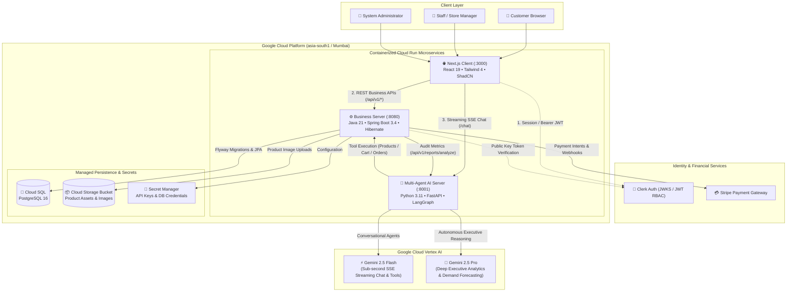
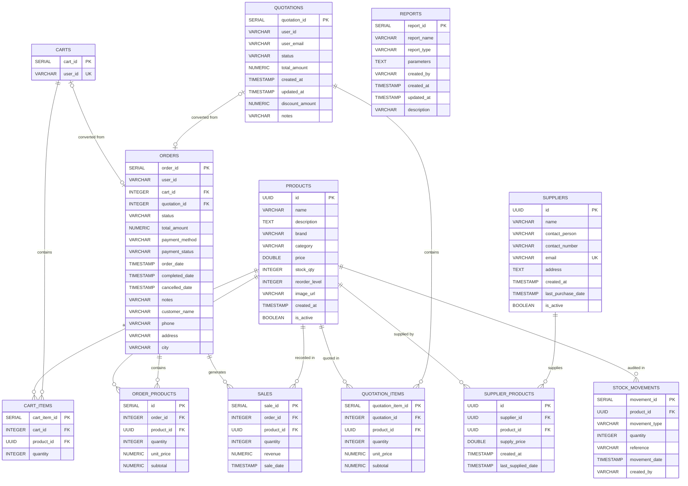
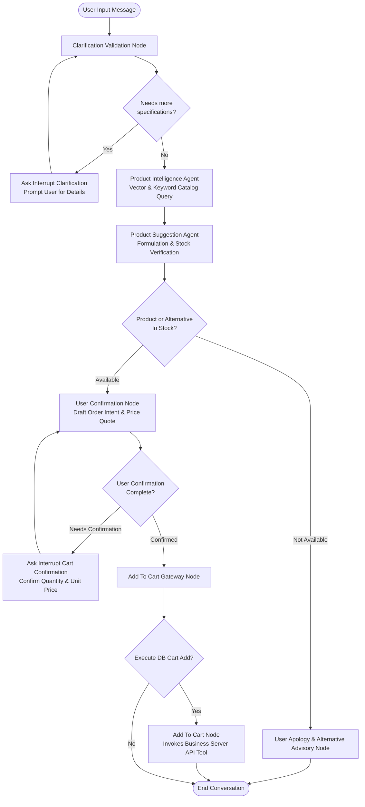
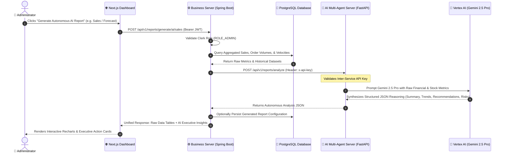

# 🛠️ Lak Chemicals and Hardware - Smart Hardware Store Management System

**Lak Chemicals and Hardware** is an enterprise-grade, modern, AI-powered store management and commerce system designed specifically for hardware and chemical retailers. It combines a high-performance **Next.js (React 19)** web client, a robust **Java 21 & Spring Boot 3.4** transactional business server (with historic **FastAPI** prototyping), and a **LangGraph-powered multi-agent AI system** built on **Google Cloud Vertex AI (Gemini 2.5 Flash & Pro)** to streamline inventory tracking, quotation pipelines, sales processing, and conversational commerce.

---

## 🏛️ System & Architecture Diagrams

### 1. High-Level Distributed System Architecture

---

### 2. Comprehensive Database Entity-Relationship Diagram (PostgreSQL 16)

The relational schema is managed via automated **Flyway** database migrations, strictly normalized to 3NF, indexed for high-concurrency read/write operations, and secured with foreign key cascade rules:

---

### 3. LangGraph Multi-Agent Conversational Workflow State Machine

The conversational assistant operates via a cyclical, human-in-the-loop state graph configured in LangGraph. Nodes dynamically validate requirement completeness, query inventory, suggest optimal formulations or alternatives, and manage cart mutations:

---

### 4. Autonomous AI Executive Report Generation Flow

---

## 🤔 Problem Space

### Problems to Solve / Requirements to Create

Traditional hardware and chemical retail operations are often plagued by manual processes, inventory discrepancies, and slow customer service. Lak Chemicals and Hardware addresses these challenges by providing:

* **A centralized platform** for inventory, supplier tracking, and order management.
* **An automated quotation system** for rapid digital price calculation and discount approval.
* **AI-driven insights** for predictive stock replenishment, sales trends, and SKU velocity analysis.
* **Secure role-based access control (RBAC)** and PCI-compliant financial transaction handling.

---

### 👉 Problem: Manual & Fragmented Operations

#### Problem Statement:
Traditional hardware and chemical retail outlets rely heavily on manual ledger entries, physical stock counting, and paper-based quotation slips. This disjointed approach frequently results in stockouts of high-demand items, overstocking of hazardous or perishable chemicals, pricing discrepancies, and severe delays in quoting industrial contractors.

#### Current Solution:
The platform delivers a unified digital operational environment that combines:
1. **Real-time stock tracking** with automated reorder thresholds and immutable movement audit logs (`RESTOCK`, `PURCHASE`, `DAMAGE_ADJUSTMENT`).
2. **End-to-end quotation workflows**: Instant quote generation from user carts, digital administrative discount adjustments, and one-click conversion into transactional orders.
3. **Supplier linkage**: Direct relationship tracking between suppliers, wholesale purchase costs, and catalog SKUs.

#### How do we know it is a problem?
* **User Feedback**: Retail customers and industrial contractors routinely reported 24-to-48 hour wait times for bespoke pricing quotes and availability confirmations.
* **Metrics**: Audits demonstrated up to **18% discrepancy** between recorded ledger quantities and actual warehouse physical stock, causing unexpected fulfillment halts.

---

### 👉 Problem: Complex Data Analysis for Business Decisions

#### Problem Statement:
Store owners and inventory managers lack accessible, analytical tools to interpret complex sales velocity, seasonal trends, holding costs, and supplier fulfillment reliability. Raw point-of-sale numbers fail to provide proactive warnings before expensive capital is tied up in stagnant inventory.

#### Current Solution:
A dual-tier AI system combining **LangGraph** conversational tools with **Google Cloud Vertex AI (Gemini 2.5 Pro)**:
1. **Button-triggered Autonomous Reports**: Instant synthesis of raw database telemetry into actionable executive takeaways (Executive Summary, SKU Velocity Trends, Procurement Directives, Imminent Stockout Warnings).
2. **Predictive Sales Forecasting**: Evaluation of 60-day historical transaction trajectories to project next 30-day demand curves.

#### How do we know it is a problem?
* **Evidence**: Overstocking of perishable chemical products (e.g., curing agents, solvent cements, reactive primers) leading to shelf-life expiration and inventory write-offs.
* **Metrics**: Store administrators spent an average of **6–8 hours weekly** compiling manual spreadsheets with zero predictive capability.

---

### 👉 Problem: Secure Role-Based Access & Payments

#### Problem Statement:
Modern commerce systems require strict segregation of privilege: sensitive financial metrics and wholesale pricing margins must remain confidential, while retail customers require effortless checkout. Furthermore, storing payment card data directly creates unacceptable security vulnerabilities and regulatory liability.

#### Current Solution:
1. **Identity & RBAC**: Integrated **Clerk Identity Management** with cryptographic **JWKS (JSON Web Key Set)** token validation. Privileges are enforced across roles (`ROLE_CUSTOMER`, `ROLE_STAFF`, `ROLE_ADMIN`) using Spring Security method-level annotations (`@PreAuthorize`).
2. **Payment Processing**: Full integration with the **Stripe Payment Gateway** via Hosted Checkout Sessions, ensuring credit card handling meets full PCI-DSS Level 1 compliance.
3. **Inter-Service Security**: Microservice communication between the Business Server, API Gateway, and Multi-Agent AI Server is secured via encrypted `x-api-key` header verification.

---

### ⭐ Why Solve These Problems?

* **Reason 1: Drastic Error Reduction & Working Capital Protection**: Eliminating manual tracking prevents inventory blind spots, stockouts of top-selling items, and costly expiration of chemical inventory.
* **Reason 2: Data-Driven Operational Profitability**: Empowering managers with automated AI predictive analytics shifts decision-making from intuition to high-accuracy, data-backed forecasting.
* **Reason 3: Modern Conversational Retail Experience**: Enabling contractors to describe their project requirements in plain language and instantly receive accurate chemical compatibility advice and cart additions accelerates the sales cycle.

---

## 🎯 Project Goals

#### Company Objective
Modernize and scale the retail and wholesale experience for hardware and chemical supplies through end-to-end digitalization, cloud-native architecture, and intelligent artificial intelligence agents.

#### Project Goals

* **High-Performance Web Client**: Build a responsive, accessible, mobile-ready frontend leveraging **Next.js (React 19)**, **Tailwind CSS 4**, and **ShadCN UI**.
* **Robust Enterprise Backend**: Deliver a resilient, ACID-compliant backend in **Java 21 & Spring Boot 3.4** with Spring Data JPA and Flyway migrations.
* **Multi-Agent AI Workflows**: Design a stateful, human-in-the-loop multi-agent commerce workflow using **LangGraph** and **Gemini 2.5** with Server-Sent Events (SSE) streaming.
* **Frictionless Financial & Auth Integrations**: Guarantee bank-grade transaction safety via **Stripe** and robust session authentication via **Clerk**.
* **Automated Cloud Infrastructure**: Package the entire system into Docker containers and deploy to **GCP Cloud Run** in `asia-south1` with **Terraform (IaC)**.

---

## 👥 User Stories

### User Type: Customer

* **Goals**: Browse chemical and hardware catalogs, inspect specifications, ask an AI assistant for product recommendations, request formal quotations, and place secure online orders.
* **Needs**: Instant fuzzy search, transparent pricing, live stock availability indicators, instant quote-to-order checkout, and seamless payment methods.
* **Characteristics**: Building contractors, DIY enthusiasts, industrial facility maintenance managers, or retail walk-in clients.
* **Key Acceptance Criteria**:
  - Customer can search for items by name or category with sub-100ms response times.
  - Customer can chat with the AI assistant in real-time to query product specs and request items be added directly to their cart.
  - Customer can submit a quote request and view approved discounted prices in their personal dashboard.

### User Type: Store Staff / Manager

* **Goals**: Track inventory levels in real-time, record stock receipts and adjustments, monitor supplier delivery histories, and fulfill customer orders.
* **Needs**: Intuitive data tables, batch stock modification forms, automated low-stock warnings, and rapid order lifecycle status updates.
* **Characteristics**: Warehouse inventory controllers, store supervisors, and counter sales staff.
* **Key Acceptance Criteria**:
  - Staff can record physical inventory movements with mandatory audit reason logging.
  - Staff receive automated alerts whenever an item dips below its configured `reorder_level`.
  - Staff can update order fulfillment states (`PENDING` → `CONFIRMED` → `DELIVERED`), which automatically creates immutable sales ledger entries.

### User Type: Administrator

* **Goals**: Oversee total business operations, review financial performance, approve quotation discounts, manage catalog SKUs, and run autonomous AI business analysis.
* **Needs**: Executive reporting dashboard, granular role-based permissions, PDF/CSV export capabilities, and predictive AI insights.
* **Characteristics**: Business owner, Chief Financial Officer, and executive operations leadership.
* **Key Acceptance Criteria**:
  - Admin can inspect, modify, and apply percentage or flat discounts to pending quotations.
  - Admin can click a single button to generate comprehensive AI executive audits for sales, inventory holding valuation, and 30-day demand predictions.
  - Admin has full CRUD authority over products, suppliers, and user role assignments.

---

## 🌟 Design Space

### UI Design
The user interface is engineered for speed, utility, and visual clarity:
* **Role-Specific Navigation**: Dynamic sidebars and top bars adapting seamlessly based on user role (`Customer`, `Staff`, `Admin`).
* **Interactive Data Tables**: Server-side pagination, category filtering, search debouncing, and sortable columns for large inventory catalogs.
* **Conversational AI Drawer**: Floating assistant accessible across all catalog pages with live SSE streaming text and interactive tool badges.
* **Executive Analytics Hub**: Interactive visual charts powered by **Recharts** displaying sales curves, product velocities, and AI-generated executive summary cards.

### Design System 🎨

#### ShadCN UI & Tailwind CSS 4

The frontend design system leverages **ShadCN UI** primitives styled with **Tailwind CSS 4**:
* **Radix UI Primitives**: 100% accessible dialogs, dropdowns, popovers, and accordions adhering to WAI-ARIA standards.
* **Modern CSS Tokens**: Utilizes Tailwind CSS 4 native cascade layers and `@theme` custom variables for consistent radii, elevation shadows, and semantic colors.
* **Visual Polish**: Curated dark and light themes, subtle glassmorphism on floating navigation bars, animated loading skeletons, and interactive state transitions powered by `motion` and `sonner` toasts.
* **Mobile Responsiveness**: Fluid grid layouts that gracefully collapse from multi-column desktop tables to compact mobile cards.

---

## 🏗️ Development Phase

### Technology Stack Selection

#### Frontend - Next.js (React 19)
* **App Router Architecture**: Optimized hybrid rendering (Server Components for static content and Client Components for dynamic state).
* **React 19 Hooks**: Leverages modern transitions, action hooks, and optimistic UI updates.
* **Streaming AI Integration**: Real-time consumption of Server-Sent Events (SSE) from the multi-agent backend for smooth, token-by-token customer conversations.
* **Type Safety**: End-to-end TypeScript interfaces matching backend DTO schemas.

#### Backend - Spring Boot 3.4 (Java 21 LTS) & FastAPI
* **Enterprise Spring Boot 3.4**: Serves as the primary transactional business engine. Chosen for its rock-solid ACID transactions, Hibernate ORM caching, Flyway migration stability, and native Spring Security filter chains.
* **Java 21 LTS Features**: Leverages Virtual Threads for high-concurrency non-blocking I/O and record classes for immutable DTOs.
* **Python FastAPI Microservice**: Operates as the dedicated AI agent execution service, providing native compatibility with the Python AI ecosystem (LangChain, LangGraph, Pydantic v2).
* **OpenAPI Documentation**: Fully documented interactive Swagger interfaces (`/swagger-ui.html`).

#### Multi-Agent Orchestration - LangGraph
* **Stateful Cyclic Workflows**: Implements cyclic decision graphs (`StateGraph`) with conditional routing edges, persistent checkpointing, and interruptible state for human confirmation.
* **Foundation Models via Vertex AI**:
  - `gemini-2.5-flash`: Chosen for zero-latency customer dialogue, entity extraction, and tool calling.
  - `gemini-2.5-pro`: Chosen for complex numerical and commercial reasoning during autonomous executive report synthesis.
* **Observability**: Integrated **Langfuse** telemetry for tracking token consumption, latency, and step-by-step agent trajectory spans.

---

#### Microservice Responsibilities & Inter-Service API Routing

| Service | Port | Primary Responsibility | Key Endpoints |
| :--- | :--- | :--- | :--- |
| **`client`** | `:3000` | User presentation, session auth, SSE consumption, client state | `/`, `/products`, `/cart`, `/checkout`, `/dashboard/reports` |
| **`business-server`** | `:8080` | ACID transaction handling, relational data persistence, Stripe payments, RBAC | `/api/v1/products`, `/api/v1/cart`, `/api/v1/quotations`, `/api/v1/orders`, `/api/v1/inventory`, `/api/v1/reports/generate/ai/*` |
| **`multi-agent-server`**| `:8001` | Conversational NLP, LangGraph state machine, tool calling, Gemini 2.5 Pro reasoning | `POST /chat` (SSE stream), `POST /api/v1/reports/analyze` (Internal API Key) |

---

## 🌟 Key Features of the Software

* **🤖 Conversational AI Commerce Assistant**:
  Customers can describe their problem (e.g., *"I need a waterproof epoxy sealant for PVC piping with high heat resistance"*). The LangGraph state machine clarifies missing specifications, queries live product inventory, suggests matching formulations or alternatives, and adds the selected items directly to their shopping cart with explicit user confirmation.

* **📑 Digital Quotation & Discount Workflow**:
  Allows contractors to generate custom quotations directly from items in their cart. Administrators can review quotes, adjust custom percentage or flat-rate discounts, add validity timestamps, and approve them. Customers can convert approved quotes into completed orders in a single click.

* **📊 5 Autonomous AI Executive Reports**:
  Store leadership can generate in-depth reports at the touch of a button. The Business Server queries raw SQL metrics and dispatches them to the AI server, where **Gemini 2.5 Pro** delivers executive-grade analysis:
  1. **Sales Performance Audit**: Revenue velocity, average order values, and category growth.
  2. **Inventory Asset Valuation**: Total asset value, holding costs, and turnover ratios.
  3. **Product Performance Analysis**: High-velocity SKUs vs. low-turnover dead stock.
  4. **Low Stock & Reorder Forecasting**: Imminent stockout warnings with recommended replenishment quantities based on supplier lead times.
  5. **30-Day Predictive Demand Forecast**: Regression-based analysis evaluating 60-day historical trends to forecast future order volumes.

* **💳 PCI-Compliant Stripe Checkout**:
  End-to-end payment integration using Stripe Hosted Checkout Sessions with webhook verification for automated order status updates (`PAID`).

* **📦 Transparent Inventory Movements & Safety Stock Audits**:
  Every stock increase or decrease is tracked in an immutable `stock_movements` table with movement types (`RESTOCK`, `PURCHASE`, `DAMAGE_ADJUSTMENT`), timestamp, and operator identity.

* **🚚 Comprehensive Supplier Relationship Tracking**:
  Direct many-to-many linkage between suppliers and product catalog entries, tracking wholesale purchase rates and last delivery dates to streamline procurement.

---

## 🚧 Challenges Faced & Solutions

### Problem 1: Orchestrating Multiple Specialized AI Agents
* **The Challenge**: Standard linear LLM chains or prompt pipelines are brittle when handling multi-turn customer conversations. If a user asks an ambiguous question, a linear chain might guess incorrectly or hallucinate inventory data that does not exist.
* **The Solution**: Utilized **LangGraph** to build a structured cyclic state machine (`StateGraph`). Implemented dedicated interruption nodes (`AskInterruptQuestionsNode`) that pause execution to elicit required technical specifications (e.g., pipe diameter, chemical grade) before executing catalog search tools. Only after a product is validated as in-stock does the graph route to confirmation and cart addition.

---

### Problem 2: Real-time Data Consistency & Stock Race Conditions
* **The Challenge**: High-volume concurrent checkouts for limited chemical stock could lead to negative inventory counts or dirty reads if two users purchase the last available unit simultaneously.
* **The Solution**: 
  1. Enforced strict database isolation levels and Spring Data JPA transactional boundaries (`@Transactional`).
  2. Created an atomic `stock_movements` log table coupled with database-level checks (`stock_qty >= 0`).
  3. Decoupled quotation requests from direct stock deductions: stock is only deducted upon order confirmation, with real-time stock verification executed at the moment of payment session creation.

---

### Problem 3: Polyglot Microservice Authentication & Zero-Trust Security
* **The Challenge**: The system spans two different backend runtimes (Java/Spring Boot and Python/FastAPI) and a Next.js client, requiring unified user authentication alongside secure inter-service communication.
* **The Solution**:
  1. **User Identity**: The client sends Clerk Bearer JWTs to the Business Server, which validates the cryptographic signature using Clerk's public JWKS endpoint without hitting third-party verification APIs on every call.
  2. **Inter-Service Mesh**: Communication from the Business Server to the AI Server (and vice versa for agent tool invocations) is secured with a shared secret header (`x-api-key`) validated using timing-safe comparisons to prevent timing attacks.

---

### Problem 4: Server-Sent Events (SSE) Streaming across Microservices
* **The Challenge**: Streaming conversational AI tokens from LangGraph through FastAPI to Next.js requires handling interrupted network connections, JSON-encoded tool calls, and clean token rendering without breaking React 19 client state.
* **The Solution**: Implemented an async generator in FastAPI that yields Server-Sent Events conforming to the format `data: {"text": "..."}` and `data: {"type": "tool_call", "tool": "..."}`. On the frontend, an optimized custom readable stream decoder processes incoming byte chunks, dispatching updates to client state without UI jitter or dropped frames.

---

## 📄 License

This project is licensed under the [MIT License](LICENSE).
