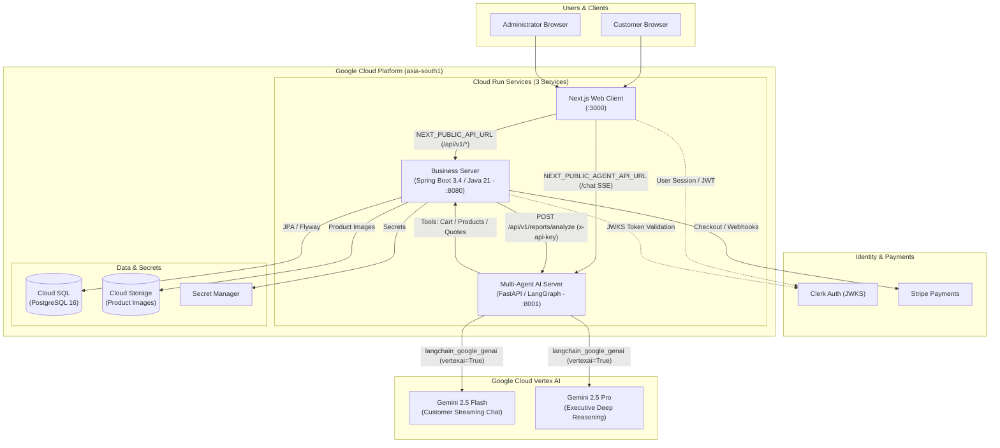

# 🛠️ Lak Chemicals and Hardware — Enterprise Cloud Architecture

**Lak Chemicals and Hardware** is an enterprise-grade, AI-powered store management and commerce system tailored for chemical and industrial hardware distributors. 

The platform features a modern **Next.js** web interface, a robust **Java 21 & Spring Boot 3.4** business engine, and an intelligent **Google Cloud Vertex AI** multi-agent reasoning server powered strictly by **`langchain_google_genai`**, orchestrated and deployed to **Google Cloud Platform (GCP)** via **Terraform** and **Cloud Run** in a streamlined, low-latency **3-tier architecture**.

---

## 🏛️ System Architecture



---

## 🚀 Key Technology Stack

### 1. Web Client (`/client`)
- **Framework**: [Next.js](https://nextjs.org/) (React 19, App Router)
- **Styling**: Tailwind CSS, ShadCN UI component library
- **Direct Ingress**: Communicates directly with `business-server` for business REST endpoints and `multi-agent-server` for real-time streaming chat, eliminating intermediate proxy latency.
- **Authentication**: Clerk Identity (`@clerk/nextjs`) with role-based routing (`ROLE_ADMIN`, Customer)
- **Visual Analytics**: Interactive report builders, downloadable PDF/CSV exports, and real-time AI Executive insight cards
- **Streaming UI**: Server-Sent Events (SSE) AI customer assistant

### 2. Business Server (`/business-server`)
- **Runtime**: Java 21 LTS (`OpenJDK 21`)
- **Framework**: Spring Boot `3.4.3`
- **Data Persistence**: Spring Data JPA with Hibernate ORM 6
- **Database Migrations**: Flyway `10.x` managing 12 relational schemas
- **Security**: Spring Security 6 with dual authentication:
  - Clerk JWKS Bearer verification for authenticated browser sessions
  - Inter-service `x-api-key` header verification for backend agents
- **AI Orchestration**: Spring 3.4 `RestClient` calling `multi-agent-server` to generate unified executive reports
- **Payments & Cloud Storage**: Stripe Java SDK (`stripe-java`) & Google Cloud Storage SDK (`google-cloud-storage`)
- **Documentation**: SpringDoc OpenAPI 3 (`/swagger-ui.html`, `/v3/api-docs`)

### 3. Multi-Agent AI Server (`/multi-agent-server`)
- **Runtime**: Python 3.11+
- **Framework**: FastAPI & LangGraph state machine
- **AI Engine**: **`langchain_google_genai`** configured directly for **GCP Vertex AI** (`vertexai=True`, `project`, `location`, API key)
  - **`gemini-2.5-flash`**: High-throughput customer conversation and product discovery
  - **`gemini-2.5-pro`**: Autonomous report reasoning, revenue velocity audits, and demand forecasting
- **Observability**: Langfuse tracing and audit telemetry

### 4. Infrastructure & DevOps (`/terraform`, `.github/workflows`)
- **Infrastructure as Code**: Terraform deploying 3 Cloud Run services to GCP **asia-south1 (Mumbai)**
- **Database & Secrets**: GCP Cloud SQL (PostgreSQL), GCP Cloud Storage, GCP Secret Manager
- **Automated CI/CD Pipeline**: GitHub Actions with multi-service automated testing gates (`mvn test`, `pytest`, `tsc --noEmit`) and keyless **Workload Identity Federation** deployment

---

## 🌟 Core Business Domains & Features

| Domain | Description | Key Capabilities |
| :--- | :--- | :--- |
| **Catalog & Products** | Complete inventory catalog | Chemical specs, industrial hardware, categories, reorder levels, image uploads |
| **Quotation Engine** | Digital quotation workflow | Auto-quote generation from carts, admin discounts, expiry dates, conversion to orders |
| **Order Management** | Transactional processing | Cart checkout, Stripe payments, order lifecycle tracking, auto sales record generation |
| **Inventory Auditing** | Stock movements & balance | Audit trail for stock adjustments, movement logs, safety stock alerts |
| **Autonomous AI Reports** | Button-triggered intelligence | **5 Autonomous Reports**: Sales Analysis, Inventory Valuation, Product Velocity, Low Stock Alert, 30-Day Predictive Demand Forecast |
| **Customer AI Assistant** | 24/7 conversational commerce | Natural language product lookup, quotation assistance, direct cart additions via tools |

---

## 📁 Repository Structure

```
lak-chemicals-and-hardware/
├── client/                     # Next.js 15+ frontend application
├── business-server/            # Java 21 / Spring Boot 3.4 business monolith
├── multi-agent-server/         # Python / FastAPI / LangGraph AI reasoning service (Vertex AI)
├── terraform/                  # Terraform modules for GCP Cloud Run, SQL, and GCS
│   ├── modules/
│   │   ├── cloud_run/          # 3 Cloud Run services (web, business, ai)
│   │   ├── cloud_sql/          # Managed PostgreSQL database instance
│   │   ├── cloud_storage/      # Product images bucket with CDN
│   │   ├── secret_manager/     # GCP Secret Manager configurations
│   │   └── vpc/                # Virtual Private Cloud & Serverless VPC Access
│   └── main.tf                 # Root Terraform manifest for asia-south1
├── .github/workflows/
│   ├── ci.yml                  # Automated multi-service CI testing pipeline
│   └── deploy.yml              # Gated Cloud Run deployment workflow
└── README.md                   # System documentation
```

---

## 🛠️ Local Development Setup

### 1. Prerequisites
- **Java 21 LTS** (`java -version`) & **Maven 3.9+**
- **Python 3.11+** & **Poetry**
- **Node.js 20+** & **npm**
- **PostgreSQL** or local Docker

### 2. Running Services Locally

#### Terminal 1 — Business Server (Spring Boot)
```bash
cd business-server
./mvnw spring-boot:run
# Listening on http://localhost:8080 (Swagger: http://localhost:8080/swagger-ui/index.html)
```

#### Terminal 2 — Multi-Agent AI Server (FastAPI)
```bash
cd multi-agent-server
poetry install
poetry run python server.py
# Listening on http://localhost:8001
```

#### Terminal 3 — Next.js Client
```bash
cd client
npm install
npm run dev
# Accessible at http://localhost:3000
```

---

## 🧪 Automated Testing Pipeline (CI)

Each service contains comprehensive automated test suites executed in GitHub Actions on every push and pull request:

```bash
# 1. Business Server (JUnit 5, Mockito, Spring Test) — 35 tests
cd business-server && ./mvnw test

# 2. Multi-Agent Server (Pytest) — Report Analysis & Vertex AI Security tests
cd multi-agent-server && poetry run pytest tests/test_report_analysis.py

# 3. Next.js Client (Strict TypeScript Verification)
cd client && npx tsc --noEmit
```

---

## 🚀 Cloud Deployment (GCP via Terraform)

To initialize and deploy infrastructure to GCP `asia-south1`:

```bash
cd terraform
cp terraform.tfvars.example terraform.tfvars
# Fill in your project_id, database passwords, and secrets

terraform init
terraform plan
terraform apply
```

The GitHub Actions workflow in [`.github/workflows/deploy.yml`](file:///.github/workflows/deploy.yml) automatically runs all unit and integration test suites, builds Docker containers, pushes images to Google Artifact Registry, and deploys to Cloud Run only if all tests pass.
