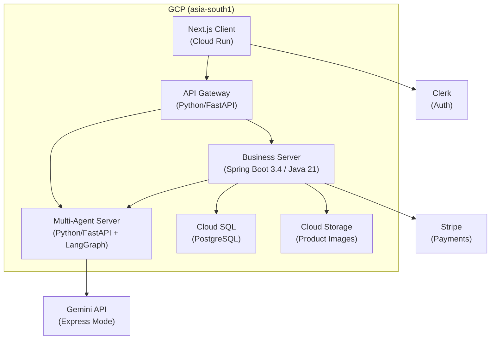
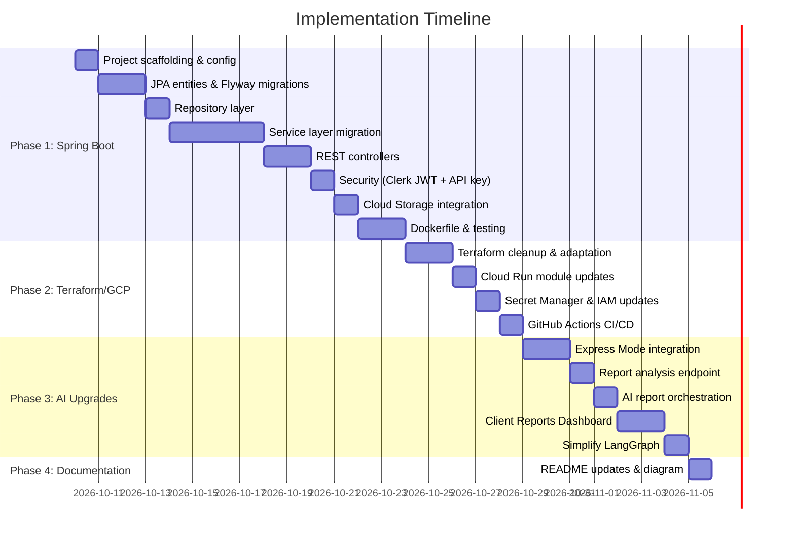

# 🚀 Lak Chemicals & Hardware — Major Upgrade Implementation Plan

> **Scope**: Migrate business-server to Spring Boot, deploy to GCP via Terraform, upgrade to Gemini Express Mode, and convert admin chat to autonomous report generation.

---

## 📋 Summary of Decisions

| Decision | Choice |
|---|---|
| Java Version | **Java 21 LTS** |
| Spring Boot | **3.4.x** |
| Data Access | **Spring Data JPA (Hibernate)** |
| Database | **Cloud SQL (prod)** + **Supabase (dev/staging)** |
| Architecture | **Single Spring Boot monolith** (9 controllers) |
| GCP Region | **asia-south1 (Mumbai)** |
| Deployment | **All 4 services on Cloud Run** |
| Terraform | Keep VPC, Cloud SQL, Artifact Registry, IAM, Cloud Storage, Secret Manager, Cloud Run. **Remove Memorystore**. Replace ImageKit with **Cloud Storage + CDN** |
| Gemini Models | **gemini-2.5-flash** (normal) + **gemini-2.5-pro** (reasoning) via **Express Mode** |
| Admin Workflow | **Button-triggered autonomous reports** (no chat) |
| Report Types | Sales, Inventory, Product Performance, Low Stock, Sales Prediction |
| Customer Workflow | **No changes** — keep existing LangGraph chat flow |
| DB Migrations | **Flyway** |
| CI/CD | **GitHub Actions + Workload Identity Federation** |
| Environment | **Single prod environment** |
| READMEs | Root, business-server, multi-agent-server, api-gateway + architecture diagram |

---

## 🏗️ Phase 1: Spring Boot Business Server Migration

> **Goal**: Rewrite the Python FastAPI `business-server` as a Java 21 + Spring Boot 3.4 + Maven REST API

### 1.1 Project Scaffolding

- [ ] Create new `business-server-java/` directory (or replace `business-server/` after backup)
- [ ] Initialize Maven project with Spring Initializr dependencies:
  - `spring-boot-starter-web`
  - `spring-boot-starter-data-jpa`
  - `spring-boot-starter-validation`
  - `spring-boot-starter-security`
  - `spring-boot-starter-actuator`
  - `postgresql` (JDBC driver)
  - `flyway-core` + `flyway-database-postgresql`
  - `lombok`
  - `stripe-java`
  - `google-cloud-storage` (replacing ImageKit)
  - `jjwt` or `spring-security-oauth2-jose` (for Clerk JWT verification)
  - `springdoc-openapi-starter-webmvc-ui` (Swagger/OpenAPI docs)
- [ ] Configure `application.yml` with profiles:
  - `default` / `dev`: Supabase PostgreSQL connection
  - `prod`: Cloud SQL PostgreSQL connection (from env vars)
- [ ] Configure Flyway with `src/main/resources/db/migration/`

### 1.2 Entity Models (JPA)

Migrate all 9 SQLAlchemy models → JPA entities:

| Python Model | Java Entity | Key Fields |
|---|---|---|
| [product_model.py](file:///c:/nadil-dulnidu/lak-chemicals-and-hardware/business-server/app/models/product_model.py) | `Product.java` | id, name, description, price, stock, category, reorderLevel, imageUrl |
| [supplier_model.py](file:///c:/nadil-dulnidu/lak-chemicals-and-hardware/business-server/app/models/supplier_model.py) | `Supplier.java` | id, name, contactInfo, address |
| [supplier_product.py](file:///c:/nadil-dulnidu/lak-chemicals-and-hardware/business-server/app/models/supplier_product.py) | `SupplierProduct.java` | supplier, product, unitPrice |
| [Inventory_model.py](file:///c:/nadil-dulnidu/lak-chemicals-and-hardware/business-server/app/models/Inventory_model.py) | `Inventory.java` | id, product, quantityChange, type, timestamp |
| [cart_model.py](file:///c:/nadil-dulnidu/lak-chemicals-and-hardware/business-server/app/models/cart_model.py) | `Cart.java` / `CartItem.java` | userId, items, quantities |
| [order_model.py](file:///c:/nadil-dulnidu/lak-chemicals-and-hardware/business-server/app/models/order_model.py) | `Order.java` / `OrderItem.java` | id, userId, items, status, totalAmount, paymentStatus |
| [quotation_model.py](file:///c:/nadil-dulnidu/lak-chemicals-and-hardware/business-server/app/models/quotation_model.py) | `Quotation.java` / `QuotationItem.java` | id, customerId, items, validUntil, status |
| [report_model.py](file:///c:/nadil-dulnidu/lak-chemicals-and-hardware/business-server/app/models/report_model.py) | `Report.java` | id, reportName, reportType, parameters, createdBy |
| [sale_model.py](file:///c:/nadil-dulnidu/lak-chemicals-and-hardware/business-server/app/models/sale_model.py) | `Sale.java` | id, product, quantity, totalPrice, saleDate |

### 1.3 Repository Layer

- [ ] Create Spring Data JPA repositories for each entity
- [ ] Use derived query methods + `@Query` for complex queries
- [ ] Implement specification patterns for filtering (reports, products)

### 1.4 Service Layer

Migrate all 9 Python services → Java services:

| Python Service | Java Service | Approx Size |
|---|---|---|
| [product_service.py](file:///c:/nadil-dulnidu/lak-chemicals-and-hardware/business-server/app/services/product_service.py) | `ProductService.java` | ~25KB logic |
| [supplier_service.py](file:///c:/nadil-dulnidu/lak-chemicals-and-hardware/business-server/app/services/supplier_service.py) | `SupplierService.java` | ~24KB logic |
| [inventory_service.py](file:///c:/nadil-dulnidu/lak-chemicals-and-hardware/business-server/app/services/inventory_service.py) | `InventoryService.java` | ~25KB logic |
| [cart_service.py](file:///c:/nadil-dulnidu/lak-chemicals-and-hardware/business-server/app/services/cart_service.py) | `CartService.java` | ~10KB logic |
| [order_service.py](file:///c:/nadil-dulnidu/lak-chemicals-and-hardware/business-server/app/services/order_service.py) | `OrderService.java` | ~19KB logic |
| [quotation_service.py](file:///c:/nadil-dulnidu/lak-chemicals-and-hardware/business-server/app/services/quotation_service.py) | `QuotationService.java` | ~25KB logic |
| [report_service.py](file:///c:/nadil-dulnidu/lak-chemicals-and-hardware/business-server/app/services/report_service.py) | `ReportService.java` | ~35KB logic |
| [payment_service.py](file:///c:/nadil-dulnidu/lak-chemicals-and-hardware/business-server/app/services/payment_service.py) | `PaymentService.java` | ~3KB logic |
| [sales_service.py](file:///c:/nadil-dulnidu/lak-chemicals-and-hardware/business-server/app/services/sales_service.py) | `SalesService.java` | ~7KB logic |

### 1.5 REST Controllers

Migrate all 9 FastAPI routers → Spring REST controllers:

| Python Router | Java Controller | Prefix |
|---|---|---|
| [product_router.py](file:///c:/nadil-dulnidu/lak-chemicals-and-hardware/business-server/app/routers/product_router.py) | `ProductController.java` | `/api/v1/products` |
| [supplier_router.py](file:///c:/nadil-dulnidu/lak-chemicals-and-hardware/business-server/app/routers/supplier_router.py) | `SupplierController.java` | `/api/v1/suppliers` |
| [inventory_router.py](file:///c:/nadil-dulnidu/lak-chemicals-and-hardware/business-server/app/routers/inventory_router.py) | `InventoryController.java` | `/api/v1/inventory` |
| [cart_router.py](file:///c:/nadil-dulnidu/lak-chemicals-and-hardware/business-server/app/routers/cart_router.py) | `CartController.java` | `/api/v1/cart` |
| [quotation_router.py](file:///c:/nadil-dulnidu/lak-chemicals-and-hardware/business-server/app/routers/quotation_router.py) | `QuotationController.java` | `/api/v1/quotations` |
| [order_router.py](file:///c:/nadil-dulnidu/lak-chemicals-and-hardware/business-server/app/routers/order_router.py) | `OrderController.java` | `/api/v1/orders` |
| [report_router.py](file:///c:/nadil-dulnidu/lak-chemicals-and-hardware/business-server/app/routers/report_router.py) | `ReportController.java` | `/api/v1/reports` |
| [stripe_router.py](file:///c:/nadil-dulnidu/lak-chemicals-and-hardware/business-server/app/routers/stripe_router.py) | `StripeController.java` | `/api/v1/stripe` |
| [agents_tools_router.py](file:///c:/nadil-dulnidu/lak-chemicals-and-hardware/business-server/app/routers/agents_tools_router.py) | `AgentToolsController.java` | `/api/v1/agents` |

### 1.6 Security Layer

- [ ] Implement Clerk JWT verification filter (`ClerkJwtAuthenticationFilter`)
  - Fetch JWKS from `https://delicate-civet-49.clerk.accounts.dev/.well-known/jwks.json`
  - Validate issuer: `https://delicate-civet-49.clerk.accounts.dev`
  - Extract `sub` claim as user ID
  - Extract `metadata.role` for admin check
- [ ] Implement API Key authentication for inter-service calls (agent tools endpoint)
- [ ] Configure Spring Security filter chain with dual auth paths

### 1.7 Image Storage Migration (ImageKit → Cloud Storage)

- [ ] Add `google-cloud-storage` dependency
- [ ] Create `CloudStorageService.java` — upload, delete, generate signed URLs
- [ ] Update product image upload/retrieval logic
- [ ] Remove ImageKit dependency entirely

### 1.8 DTO/Schema Layer

- [ ] Create request/response DTOs matching existing Pydantic schemas
- [ ] Add Jakarta Bean Validation annotations (`@NotNull`, `@Size`, etc.)
- [ ] Implement custom validators where needed

### 1.9 Dockerfile

```dockerfile
# Multi-stage build
FROM maven:3.9-eclipse-temurin-21 AS build
WORKDIR /app
COPY pom.xml .
RUN mvn dependency:go-offline
COPY src ./src
RUN mvn package -DskipTests

FROM eclipse-temurin:21-jre-alpine
WORKDIR /app
COPY --from=build /app/target/*.jar app.jar
EXPOSE 8080
ENTRYPOINT ["java", "-jar", "app.jar"]
```

### 1.10 Testing

- [ ] Unit tests for services with `@MockBean`
- [ ] Integration tests with `@SpringBootTest` + `@Testcontainers` (PostgreSQL)
- [ ] Verify all existing API contracts are preserved

---

## 🌐 Phase 2: Terraform & GCP Deployment

> **Goal**: Adapt the existing HireWise Terraform to deploy all 4 Lak Chemicals services to GCP Cloud Run in `asia-south1`

### 2.1 Terraform Cleanup & Adaptation

- [ ] **Rename project references**: `HireWise` → `LakChemicals` (or `lak-chemicals`)
- [ ] **Update region**: `us-central1` → `asia-south1`
- [ ] **Update GitHub repo**: `Nadil-Dulnidu/HireWise` → `Nadil-Dulnidu/lak-chemicals-and-hardware`
- [ ] **Remove Memorystore module** — delete `modules/memorystore/` entirely and remove from `main.tf`
- [ ] **Remove calendar-related APIs** from `gcp_services` list
- [ ] **Update Secret Manager** — remove `resend_api_key`, `google_calendar_credentials_json`; add `stripe_secret_key`, `imagekit` → remove
- [ ] **Update variables.tf** — clean up HireWise-specific variables, add Lak-specific ones

### 2.2 Cloud Run Module Updates

The current Cloud Run module has 3 services (ai_service, api, web). Changes needed:

- [ ] **Rename `api` service** (currently labeled "ASP.NET Core 8") → Spring Boot Java API
  - Update container port: `8080` (Spring Boot default)
  - Update environment variables for Spring Boot (`SPRING_PROFILES_ACTIVE`, `SPRING_DATASOURCE_URL`, etc.)
  - Remove ASP.NET-specific env vars (`ASPNETCORE_ENVIRONMENT`, etc.)
  - Add reference to AI service URL for report generation orchestration
- [ ] **Add `api_gateway` service** — new 4th Cloud Run service for the Python API gateway
  - Container port: `8002`
  - Environment variables: `BUSINESS_BASE_URL`, `AGENT_BASE_URL` (pointing to other Cloud Run service URIs)
- [ ] **Update `ai_service`** — keep Python FastAPI, update env vars for Express Mode
- [ ] **Update `web` service** — change label from "React / Vite" to "Next.js", update env vars:
  - `NEXT_PUBLIC_API_BASE_URL` (pointing to API gateway Cloud Run URI)
  - `NEXT_PUBLIC_CLERK_PUBLISHABLE_KEY`

### 2.3 Cloud Storage Module Updates

- [ ] **Repurpose storage bucket** — from "Resumes Bucket" to "Product Images Bucket"
- [ ] Configure public read access for product images
- [ ] Optional: Add CDN configuration via Cloud CDN or signed URL caching
- [ ] Grant `objectCreator` + `objectViewer` roles to backend service account

### 2.4 Secret Manager Updates

Update secrets for this project:

| Secret | Source |
|---|---|
| `database_url` | Cloud SQL connection string |
| `clerk_secret_key` | Clerk backend secret |
| `clerk_webhook_signing_secret` | Clerk webhook secret |
| `ai_service_api_key` | Inter-service API key |
| `stripe_secret_key` | Stripe secret key (new) |
| `genai_api_key` | Gemini API key for Express Mode (new) |

### 2.5 IAM & Workload Identity

- [ ] Update GitHub repo in Workload Identity Pool: `Nadil-Dulnidu/lak-chemicals-and-hardware`
- [ ] Add `aiplatform.user` role to backend SA for Gemini API (if using Vertex AI alongside Express Mode)
- [ ] Add `storage.objectAdmin` role for Cloud Storage image management

### 2.6 GitHub Actions CI/CD Pipeline

- [ ] Create `.github/workflows/deploy.yml`:

```yaml
# Workflow structure:
name: Deploy to GCP
on:
  push:
    branches: [main]

jobs:
  # 1. Build & push business-server (Java) Docker image
  # 2. Build & push multi-agent-server (Python) Docker image
  # 3. Build & push api-gateway (Python) Docker image
  # 4. Build & push client (Next.js) Docker image
  # 5. Deploy all 4 to Cloud Run via gcloud
```

- [ ] Use Workload Identity Federation for keyless authentication
- [ ] Build Docker images → push to Artifact Registry → deploy to Cloud Run
- [ ] Add path-based triggers (only rebuild changed services)

### 2.7 Terraform Environment Config

- [ ] Create `terraform.tfvars` (gitignored) with:
  ```hcl
  project_id    = "<your-gcp-project-id>"
  project_name  = "lak-chemicals"
  environment   = "prod"
  region        = "asia-south1"
  github_repo   = "Nadil-Dulnidu/lak-chemicals-and-hardware"
  ```
- [ ] Remove `environments/` directory (single env for now)
- [ ] Add `.tfvars.example` for reference

---

## 🤖 Phase 3: Gemini Express Mode + Autonomous Admin Reports

> **Goal**: Upgrade AI service to use Gemini Express Mode and replace admin chat with button-triggered report generation

### 3.1 Gemini Express Mode Integration

- [ ] **Replace `langchain_google_genai`** with direct `google-genai` SDK for Express Mode:
  ```python
  from google import genai
  
  client = genai.Client(api_key="...", express_mode=True)
  ```
- [ ] **Create LangChain-compatible wrapper** (`ExpressModeChat`) that implements the `BaseChatModel` interface so LangGraph agents can use it transparently
- [ ] **Update LLM managers**:
  - [genai_llm.py](file:///c:/nadil-dulnidu/lak-chemicals-and-hardware/multi-agent-server/app/core/llm/genai_llm.py) — use `gemini-2.5-flash` via Express Mode
  - [genai_reasoning_llm.py](file:///c:/nadil-dulnidu/lak-chemicals-and-hardware/multi-agent-server/app/core/llm/genai_reasoning_llm.py) — use `gemini-2.5-pro` via Express Mode
- [ ] **Update config.json** — new model names:
  ```json
  {
    "genai_normal": { "model_name": "gemini-2.5-flash", ... },
    "genai_reasoning": { "model_name": "gemini-2.5-pro", ... }
  }
  ```
- [ ] **Update pyproject.toml** — add `google-genai` dependency, possibly keep `langchain-google-genai` for compatibility

### 3.2 New Report Analysis Endpoint (Multi-Agent Server)

- [ ] **Create new router**: `app/routers/report_analysis_router.py`
  ```
  POST /api/v1/reports/analyze
  ```
  - Accepts: `{ "report_type": "SALES|INVENTORY|...", "data": {...raw report data...} }`
  - Returns: `{ "summary": "...", "insights": [...], "recommendations": [...] }`
  - Non-streaming (regular JSON response)
  - Authenticated via API key (inter-service)

- [ ] **Create report analysis service**: `app/services/report_analysis_service.py`
  - Takes raw report data from business-server
  - Uses Gemini (reasoning model) to generate AI insights
  - Returns structured analysis with:
    - Executive summary
    - Key insights / trends
    - Actionable recommendations
    - Risk alerts (e.g., low stock warnings)

- [ ] **Simplify LangGraph admin flow**:
  - Remove the admin chat branch from [graph_builder.py](file:///c:/nadil-dulnidu/lak-chemicals-and-hardware/multi-agent-server/app/core/graph/graph_builder.py)
  - Remove admin-related nodes: `analytics_query_validation`, `analytics_router`, `inventory_analytics`, `product_performance`, `sales_analytics`, `sales_prediction`
  - Remove `_cheack_is_admin` routing from START node
  - The graph now only handles customer flow (simplification)

### 3.3 AI Report Orchestration (Business Server — Spring Boot)

- [ ] **Create `AiReportController.java`**: `POST /api/v1/reports/generate/ai/{type}`
  - `type` = `sales`, `inventory`, `product-performance`, `low-stock`, `sales-prediction`
  - Admin-only (Clerk JWT + admin role check)
  - Flow:
    1. Fetch raw report data from the existing `ReportService` (DB query)
    2. Call multi-agent-server's `/api/v1/reports/analyze` endpoint with the raw data
    3. Combine raw data + AI insights into a unified response
    4. Return to client

- [ ] **Create `AiServiceClient.java`** — HTTP client to call multi-agent-server
  - Use Spring's `RestClient` (Spring Boot 3.4)
  - Include API key header for inter-service auth
  - Timeout configuration
  - Error handling

### 3.4 Client-Side Changes (Next.js)

> [!NOTE]
> The client changes are minimal — primarily adding a Reports Dashboard page for the owner.

- [ ] **Create Reports Dashboard page** (`/dashboard/reports`)
  - 5 report type cards (Sales, Inventory, Product Performance, Low Stock, Sales Prediction)
  - Each card has a "Generate Report" button
  - Optional: date range picker for Sales/Product Performance reports
  - Loading states during generation
  - Display formatted report results with charts/tables

- [ ] **Remove admin chat interface** (or hide behind feature flag)
- [ ] **Add API client function** for `POST /api/v1/reports/generate/ai/{type}`

---

## 📝 Phase 4: README Updates

> **Goal**: Update all READMEs to reflect the new architecture

### 4.1 Root README.md

- [ ] Update technology stack section:
  - Backend: FastAPI → **Spring Boot 3.4 (Java 21)**
  - AI: Add **Gemini Express Mode**
  - Deployment: Add **GCP Cloud Run + Terraform**
  - Storage: ImageKit → **GCP Cloud Storage**
- [ ] Add **architecture diagram** (Mermaid):



- [ ] Update deployment instructions for GCP
- [ ] Update local development setup

### 4.2 business-server/README.md

- [ ] Complete rewrite for Java/Spring Boot:
  - Prerequisites (Java 21, Maven)
  - Build instructions (`mvn clean package`)
  - Run locally (`mvn spring-boot:run`)
  - API documentation (Swagger UI link)
  - Environment configuration
  - Database setup & Flyway migrations

### 4.3 multi-agent-server/README.md

- [ ] Update for Gemini Express Mode
- [ ] Document new `/api/v1/reports/analyze` endpoint
- [ ] Document simplified graph (customer-only flow)
- [ ] Update model references (gemini-2.5-flash / gemini-2.5-pro)

### 4.4 api-gateway/README.md

- [ ] Update routing table (if any routes changed)
- [ ] Document new report routes proxied to business-server

---

## 📊 Execution Order & Dependencies



---

## ⚠️ Risk Register

| Risk | Impact | Mitigation |
|---|---|---|
| Data model mismatch during Spring Boot migration | High | Validate Flyway migrations against existing Supabase schema before running on prod |
| Express Mode API limits / quotas | Medium | Implement fallback to standard Vertex AI if Express Mode hits rate limits |
| Cloud Run cold starts for Java | Medium | Use Spring Boot 3.4 AOT compilation or GraalVM native image; set min instances = 1 for prod |
| Breaking API contracts during migration | High | Write integration tests comparing Python ↔ Java responses; keep same endpoint paths |
| Terraform state conflicts | Medium | Use remote state backend (GCS bucket) before running any `terraform apply` |

---

> [!IMPORTANT]
> **Before starting Phase 1**, back up the existing `business-server/` directory and ensure all current tests pass. The Python server should remain functional throughout the migration until the Spring Boot version is verified.

Ready to proceed? Click **Proceed** to start with **Phase 1: Spring Boot Migration** (project scaffolding).
